 

**Vaibhav Singh** · Senior AI Software Engineer @ [Spoto.in](https://spoto.in)  
Gorakhpur, Uttar Pradesh · Bengaluru (Remote)

[LinkedIn](https://www.linkedin.com/in/vaibhav-singh-2a5991229/)
·
[Email](mailto:vaibhavsingh273010@gmail.com)
·
[Portfolio](https://vaibhav-singh05.github.io/Portfolio-Website/)
·
[GitHub](https://github.com/vaibhav-singh05)

---

### Now shipping
- **Medical Counselling Center** — Django, PostgreSQL, Razorpay, Nginx · [live](https://medicalcounsellingcenter.com/)
- **Unibook** — student book exchange · [live](https://unibook-krly.onrender.com) · [code](https://github.com/vaibhav-singh05/UniBook)
- **Vani** — Django e-commerce · [live](https://vani-6hcu.onrender.com) · [code](https://github.com/vaibhav-singh05/Vani)

### Also built
- [Task Manager Pro](https://task-manager-a4jc.onrender.com) · [Quora Clone](https://quora-phjc.onrender.com) · [Educa](https://vaibhav-singh05.github.io/Educa-Web/)

  

